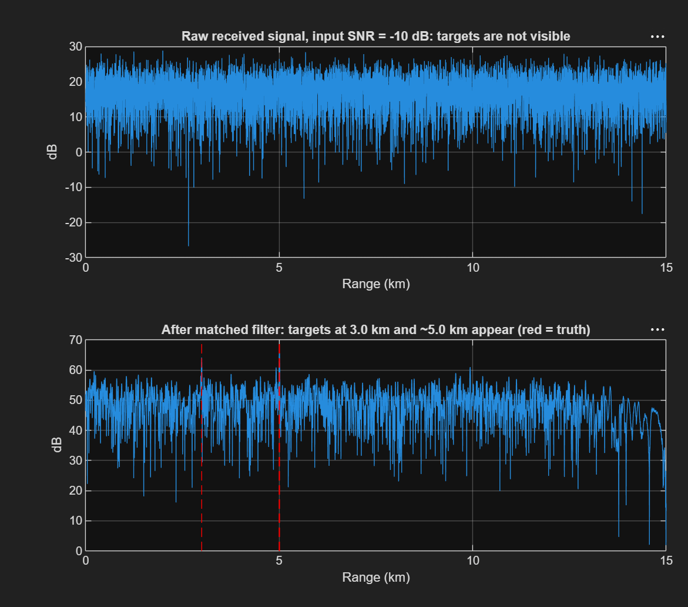
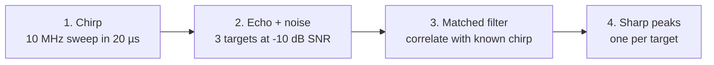
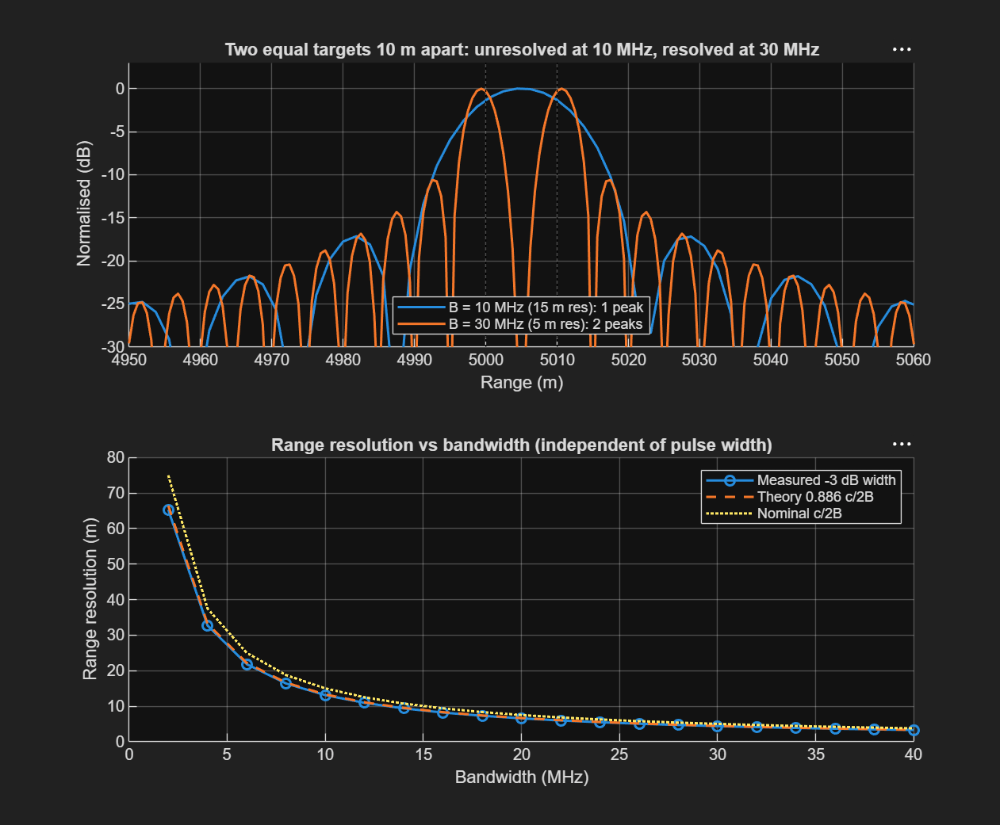
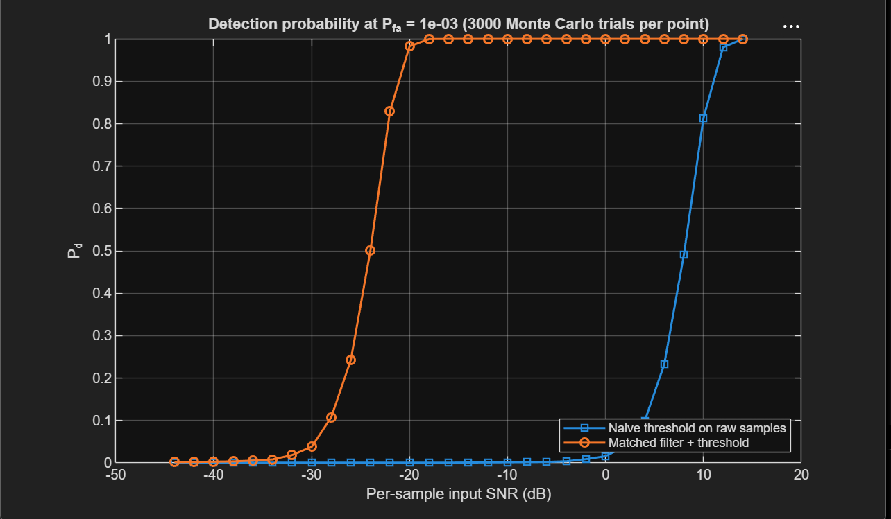
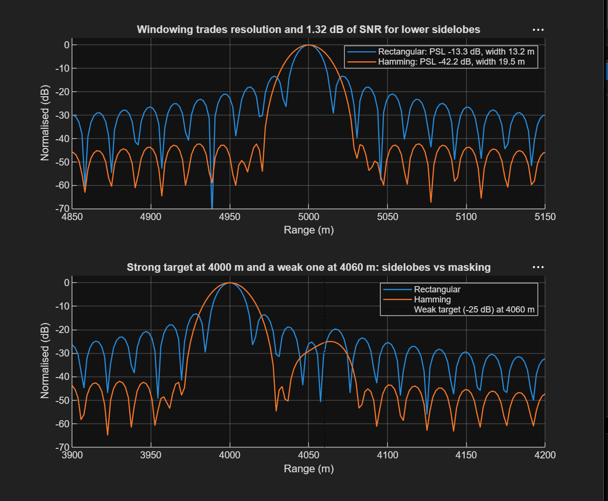
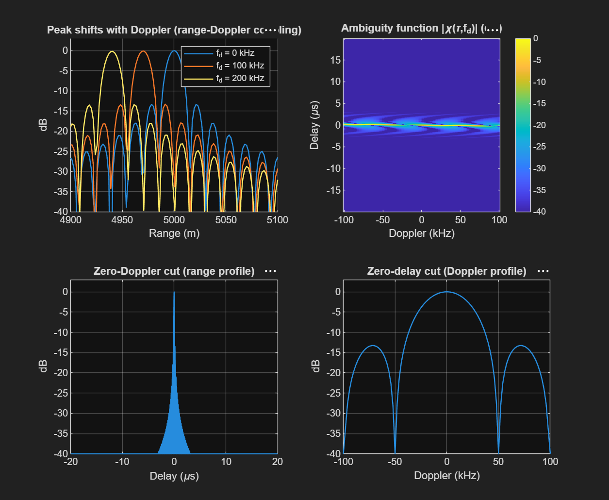

# Finding Radar Targets Buried 10× Below the Noise

**Radar pulse compression in MATLAB: an LFM chirp and a matched filter, built from scratch and checked against theory.**

*Top: what the radar receives at −10 dB SNR. The noise is 10× stronger than the signal, and the targets are invisible. Bottom: the same data after the matched filter, with sharp peaks at the true ranges (red lines).*

---

## The 20-second version

- **Problem.** Radar needs long pulses to see far, but short pulses to separate close targets. A plain pulse cannot do both.
- **What I built.** A complete pulse-compression chain: a linear-FM chirp, noisy multi-target echoes, and a matched filter implemented two ways (time domain and FFT). Every stage is written from first principles in core MATLAB.
- **Result.** Three targets recovered from noise at **−10 dB SNR**, with every measured number landing on its textbook value.

## Results at a glance

| What I tested | Result |
|---|---|
| Targets found at −10 dB input SNR | **3 of 3**, at the correct ranges |
| Pulse-compression gain | **≈ 23 dB** (theory: 10·log₁₀(200) = 23.0 dB) |
| Two targets 10 m apart | **Merged at 10 MHz, resolved at 30 MHz** (resolution = c/2B) |
| Sidelobes with a Hamming window | **−13.3 dB → −42.2 dB**, for 1.32 dB of SNR |
| Range error from target motion (200 kHz Doppler) | **60 m**, matching the formula |
| Detection advantage over a raw threshold | **≈ 32 dB** at P_d = 0.5, P_fa = 10⁻³ |

## Why it matters

Pulse compression is the core idea behind modern pulsed radar, including air-traffic surveillance, weather and defence systems. It is also the foundation for more advanced topics such as CFAR detection, Doppler processing and waveform design. This project is my groundwork in **RF and radar signal processing**.

## How it works

1. **Chirp.** A 20 µs pulse whose frequency sweeps 10 MHz. Long, so it carries energy; wide-band, so it can be compressed to a sharp peak.
2. **Echo.** Delayed copies from targets at 3000 m, 5000 m and 5010 m, buried in noise.
3. **Matched filter.** Slide the known chirp along the received signal and measure the match at each position.
4. **Peaks.** Energy that was spread over 20 µs collapses into a narrow peak, about 23 dB above the noise.

## Key figures

<table>
  <tr>
    <td width="50%"> <b>Resolution comes from bandwidth.</b> The 10 m pair merges at 10 MHz and splits at 30 MHz, and the measured width follows 0.886·c/2B.</td>
    <td width="50%"> <b>Detection.</b> The matched filter reaches 50% detection at about −24 dB per-sample SNR, against about +8 dB for a raw threshold.</td>
  </tr>
  <tr>
    <td width="50%"> <b>The windowing trade-off.</b> Hamming cuts sidelobes sharply so a weak target next to a strong one becomes visible, at the cost of a wider peak.</td>
    <td width="50%"> <b>Moving targets.</b> A chirp's compressed peak shifts with Doppler (range-Doppler coupling), exactly as the formula predicts.</td>
  </tr>
</table>

## How I know the results are correct

- **Two matched-filter implementations** (direct convolution and FFT) are compared, and they agree to numerical precision.
- **Every metric is compared with a closed-form theory value:** gain, −3 dB resolution, sidelobe level, Doppler shift and detection gap.
- **Averaged measurements.** Output noise power is averaged over 100 runs, and detection curves use thousands of Monte Carlo trials per point.
- **False-alarm rate is checked,** so the detection thresholds are verified, not assumed.
- **Optional toolbox cross-check** against MATLAB's Phased Array System Toolbox, skipped automatically if it is not installed.
- **Reproducible.** The random seed is fixed, and a full theory-vs-measured table is written to `results.txt` on every run.

## Skills demonstrated

**Radar signal processing** (LFM waveforms, matched filtering, pulse compression, ambiguity function, range-Doppler coupling) · **Detection theory** (thresholds, P_fa, P_d, Monte Carlo) · **DSP** (FFT-based correlation, windowing, spectral analysis, complex baseband sampling) · **MATLAB** (vectorised code, local functions, automated figure and report generation) · **Verification mindset** (testing every result against theory)

## Run it

1. Download `radar_chirp_matched_filter.m`.
2. Open it in MATLAB and press **Run**. No toolbox is needed.
3. Open the `figures` folder and `results.txt`, both created next to the script, for the plots and the theory-vs-measured table.

**Prefer to watch?** A 6-minute narrated visual walkthrough of the whole project is in [`media/Radar_Pulse_Compression_Narrated.mp4`](media/Radar_Pulse_Compression_Narrated.mp4).

---

<b>Simulation parameters</b>

| Parameter | Value | Why it matters |
|---|---|---|
| Bandwidth B | 10 MHz | Sets range resolution (c/2B = 15 m) |
| Pulse width T | 20 µs | Sets pulse energy |
| Time-bandwidth product | 200 | Sets compression gain (≈ 23 dB) |
| PRI | 100 µs | Unambiguous range = 15 km |
| Sample rate | 80 MHz (8× oversampling, complex baseband) | Smooth, accurate curves |
| Chirp rate k = B/T | 5×10¹¹ Hz/s | Slope of the frequency ramp |
| Input SNR | −10 dB (in bandwidth B) | Noise variance scaled by fs/B |
| Targets | 3000 m, 5000 m, 5010 m | The last two are 10 m apart, inside the 15 m resolution cell |

<b>Full results: theory vs measured</b>

| Metric | Theory | Measured* |
|---|---|---|
| Pulse compression gain (dB) | 23.01 | ≈ 23.0 |
| −3 dB range resolution, rectangular (m) | 13.29 | 13.2 |
| Peak sidelobe, rectangular (dB) | −13.26 | −13.3 |
| Peak sidelobe, Hamming (dB) | n/a | −42.2 |
| Hamming mainlobe width (m) | n/a | 19.5 (about 1.5× wider) |
| Hamming SNR loss (dB) | n/a | 1.32 |
| −10 dB bandwidth (MHz) | 10 | 10.26 |
| Peaks for the 10 m pair at 10 MHz / 30 MHz | 1 / 2 | 1 / 2 |
| Range shift at 100 kHz / 200 kHz Doppler (m) | 30 / 60 | ≈ 30 / ≈ 60 |
| Detection gap, raw vs matched filter (dB) | 32.0 | ≈ 32 |

\* From the MATLAB run (seed 42); `results.txt` is regenerated on every run.

**Why 32 dB and not 23 dB?** The detection test uses per-sample SNR, so the matched filter gains 10·log₁₀(1600) = 32 dB over a single-sample threshold. That is the 23 dB compression gain plus 9 dB from the 8× oversampling.

<b>Code structure</b>

The script is organised into eleven numbered sections, each testing one claim: parameters, chirp generation, noisy echo, matched filter (two ways), gain and resolution, resolution vs bandwidth, sidelobes and windowing, Doppler and the ambiguity function, detection probability, toolbox cross-check, and the results table.

Local functions: `make_chirp`, `make_echo` (analytic fractional delay, optional Doppler), `noise_matrix`, `mfilt` (FFT matched filter with optional window), `hamm`, `pulse_metrics` (interpolated −3 dB width and peak sidelobe), and the helpers `pair_response`, `count_peaks` and `interp_cross`.

<b>Limitations and next steps</b>

**Current scope:** a single pulse, ideal point targets in white Gaussian noise, a fixed threshold set from the known noise level, and complex baseband only (no RF front-end effects).

**Next steps:**

1. CFAR detection, so the threshold adapts to the noise.
2. Multi-pulse Doppler processing and a range-Doppler map.
3. Comparison with other waveforms: Barker codes and nonlinear FM.
4. Taylor and Chebyshev windows, or mismatched filters, for sidelobe control.
5. Clutter and fluctuating (Swerling) targets.

<b>Troubleshooting</b>

- **Ambiguity function looks flat:** with the default ±100 kHz Doppler axis the ridge shifts only 0.2 µs. Widen the Doppler axis to about ±5 MHz to see the diagonal ridge.
- **Toolbox lines missing from `results.txt`:** the Phased Array System Toolbox is not installed. This is expected and does not affect the main results.

---

**Author:** Srishti Tiwari · Electronics and Communication Engineering, JSS Academy of Technical Education, Noida · RF and radar signal processing

**References:** Skolnik, *Introduction to Radar Systems* · Richards, *Fundamentals of Radar Signal Processing* · Levanon and Mozeson, *Radar Signals*
